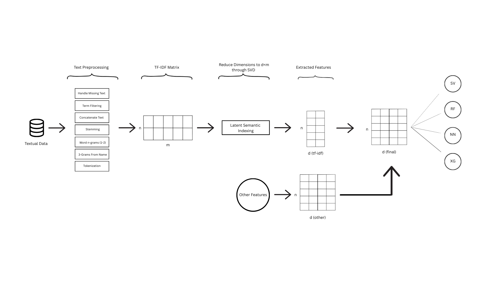

# InClass Kaggle Competition: Price Suggestion Prediction for Online Resale
## Machine Learning – Team 11 

### Team Members

- **Febe De Smet** (02103805) – Febe.desmet@ugent.be  
- **Henri Bolliou** (02112399) – Henri.bolliou@ugent.be  
- **Liam Kielemoes** (02111046) – Liam.kielemoes@ugent.be  
- **Lucas Minnaert** (02113094) – Lucas.minnaert@ugent.be  

**Instructor:** Prof. Dr. Dries Benoit  
**Teaching Assistant:** Lukas De Kerpel  
**Academic Year:** 2025–2026  

---

## Project Overview

This repository contains all code, documentation, and results produced by Team 11 for the Machine Learning course at Ghent University.

The objective of this project was to:

- Develop an end-to-end machine learning pipeline for predicting prices of online resale products  
- Apply reproducible methods for:  
  - data preprocessing  
  - feature engineering  
  - hyperparameter tuning  
  - model validation  
  - test-set prediction  
- Participate in the Kaggle competition, evaluated using RMSE

For a detailed description of the data preprocessing pipeline, feature engineering decisions, model specifications, hyperparameter tuning procedures, and empirical results, we refer to the accompanying technical report (`Doc/technical_report.pdf`).

---

## Repository Structure

The repository is organized according to the principles of *Good Enough Practices in Scientific Computing*, ensuring a clear separation between data, source code and documentation.

```text
.
├── Data/
│   └── Submissions/              # All data files and all Kaggle submission CSVs
│
├── Doc/
│   ├── team11_technical_report.pdf      
│   ├── team11_poster.pdf       
│   └── plots/                    # Figures and visualizations
│
├── Src/
│   ├── Data Engineering/         # Data cleaning and feature engineering scripts
|   |                             # (run in the specified order)
│   │
│   └── Models/                   # All models trained on the Gold basetable
│
├── .gitignore
├── README.md
└── Team11.Rproj
```
The Src/Models directory contains all model-building scripts used to train, tune, and evaluate the different considered algorithms. Each script implements the full training and validation pipeline for that model.

For **XGBoost and MLP**, two separate subdirectories are present (**XgBoost** / **xgboost2** and **MLP** / **MLP2**). This reflects the fact that these models were trained and tuned on two different feature representations: the baseline basetable and a model-specific optimized dataset. In particular, XGBoost was additionally trained on a feature set without SVD components and with sample weights for high-priced items, while the MLP was trained on a higher-dimensional SVD representation (k = 150 instead of 100).

Each subdirectory contains the tested hyperparameter configurations as well as the corresponding best-performing model, ensuring full transparency and reproducibility of the model selection process.


## Data Engineering Pipeline (Medallion Architecture)

We implemented a **Bronze → Silver → Gold** data structure to ensure reproducibility and a clear separation of processing stages.
Due to GitHub file size limitations, the intermediate datasets corresponding to these stages are **not stored in the repository** but are **generated locally by executing the data engineering scripts in the prescribed order**.

---

### 🥉 Bronze — Raw Ingestion
- Import of the complete original dataset  
  *(not included in the repository due to file size limitations)*  
- Minimal preprocessing steps:
  - NA checks  
  - Data type corrections  
  - Basic string normalization  

---

### 🥈 Silver — Cleaned & Augmented

#### Categorical Variables
- Decomposition of `category_name` into three hierarchical levels

#### Normalization of `brand_name`
- Regex-based cleaning  
- Harmonization of frequent brand variants  

#### Text Preprocessing for `title` and `item_description`
- Lowercasing  
- Stopword removal  
- Stemming  
- Truncation to 90 words (95th percentile)  

#### Text Features
- Construction of a sparse TF-IDF matrix using text2vec  
- Dimensionality reduction via SVD   

---

### 🥇 Gold — Basetable
- Complete feature set, combining structured and text-derived variables  
- Final train/validation/test dataset splits  
- Storage in '.rds' files (memory efficiency)  
  

---

## Model Architecture

All models were trained on the **Gold basetable** (or a variant of this), using the following validation strategy:
- **Hyperparameter tuning** on the training set using k-fold cross-validation
- **Retraining** on the full training set using the optimal hyperparameters
- **Evaluation** on the hold-out validation set
- **Selection** of the best-performing model based on validation performance
- **Final retraining** on the combined *train + validation* data
- Generation of **predictions on the test set** for submission to Kaggle 
---

### Trained Models

#### Linear Models
- Ordinary Least Squares (OLS)  
- Ridge Regression  
- Lasso Regression  

#### Generalized Additive Models (GAM)
- Smoothing splines (on five non-linear predictors)
#### Tree-based Models
- Decision Tree  
- Bagging  
- Random Forest  
- BART  
- Gradient Boosting  
- XGBoost  
- LightGBM  

#### Support Vector Machines (SVM)
- Linear kernel  
- Non-linear kernel  

#### Neural Network
- Multi-Layer Perceptron (MLP)   

---

